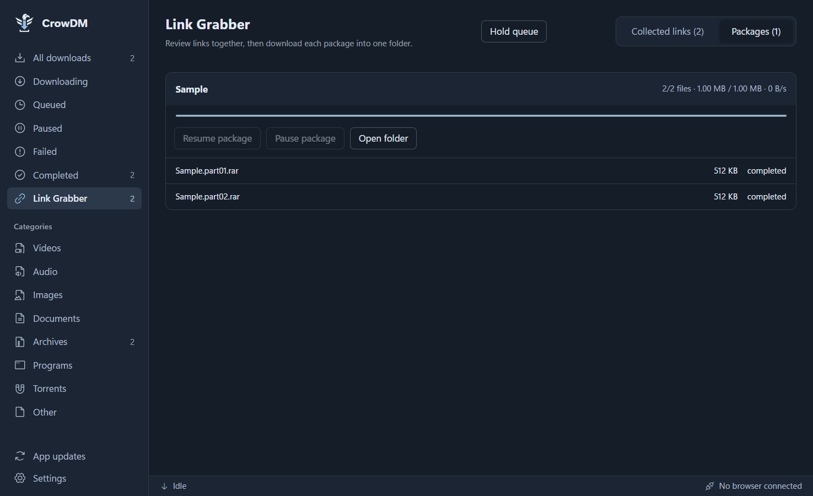
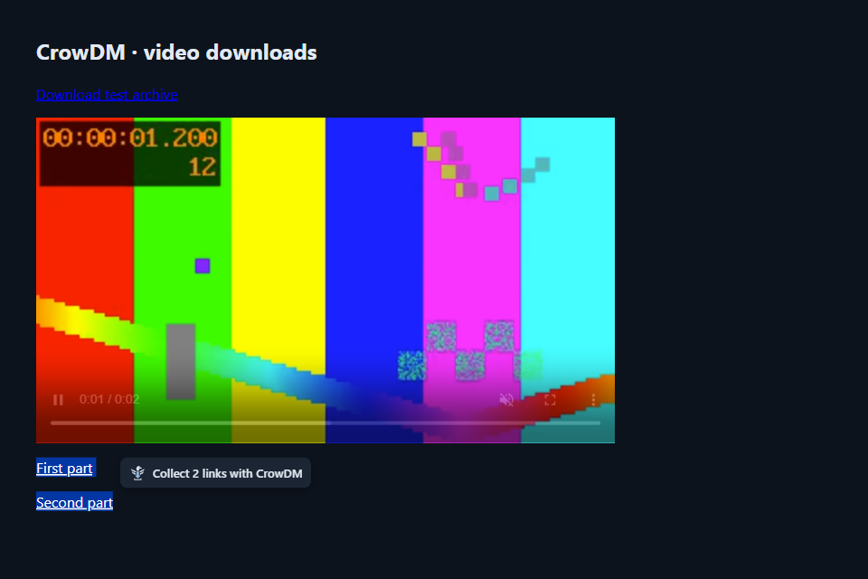
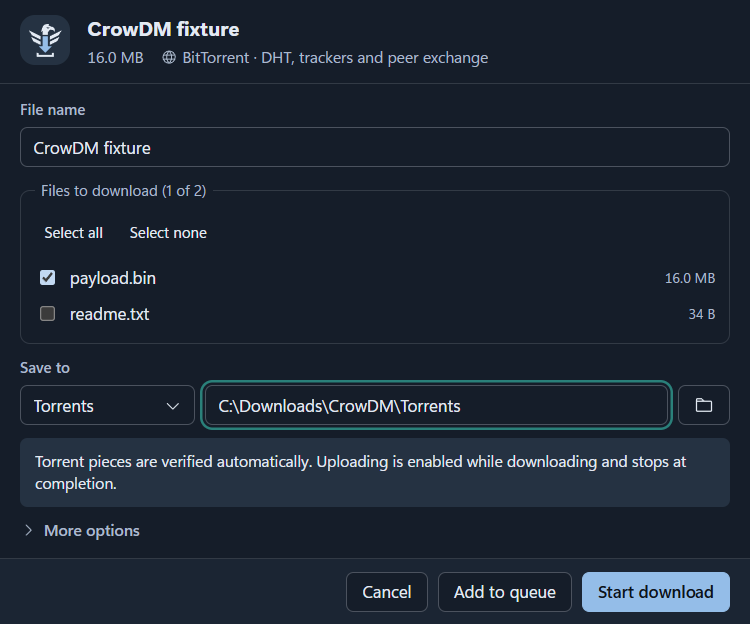
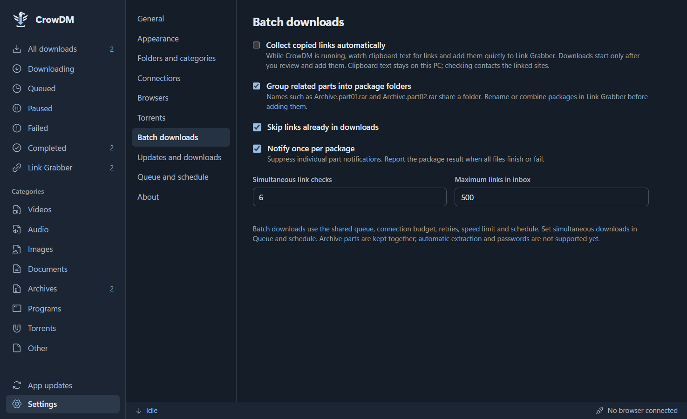
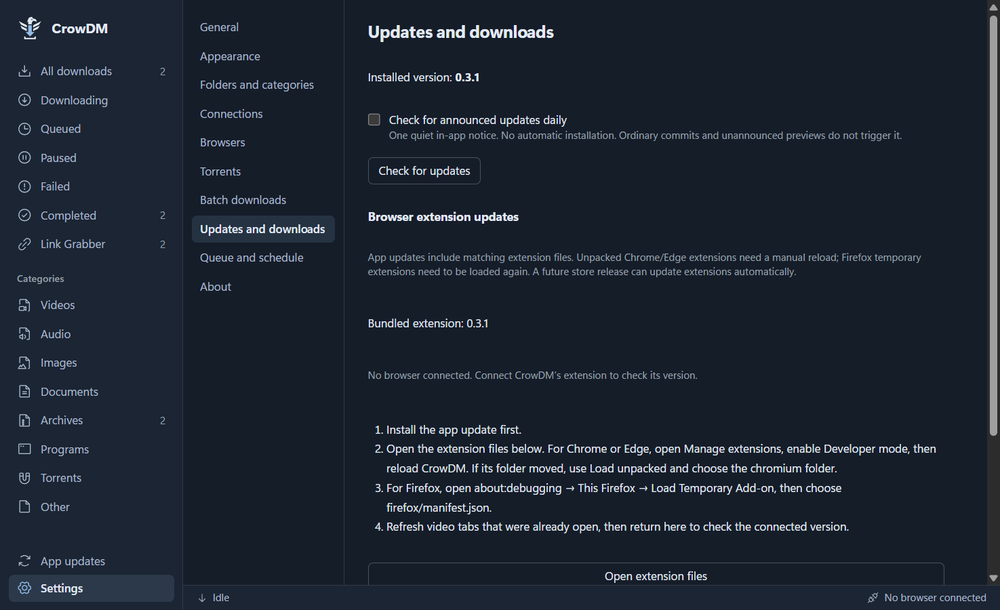
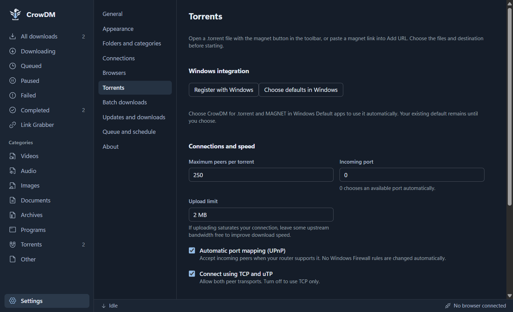
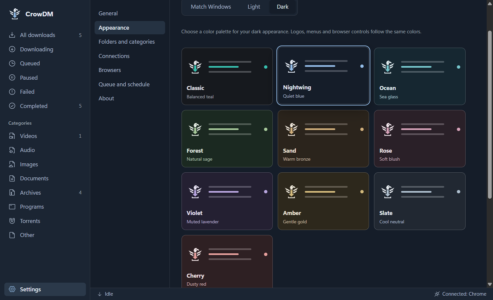
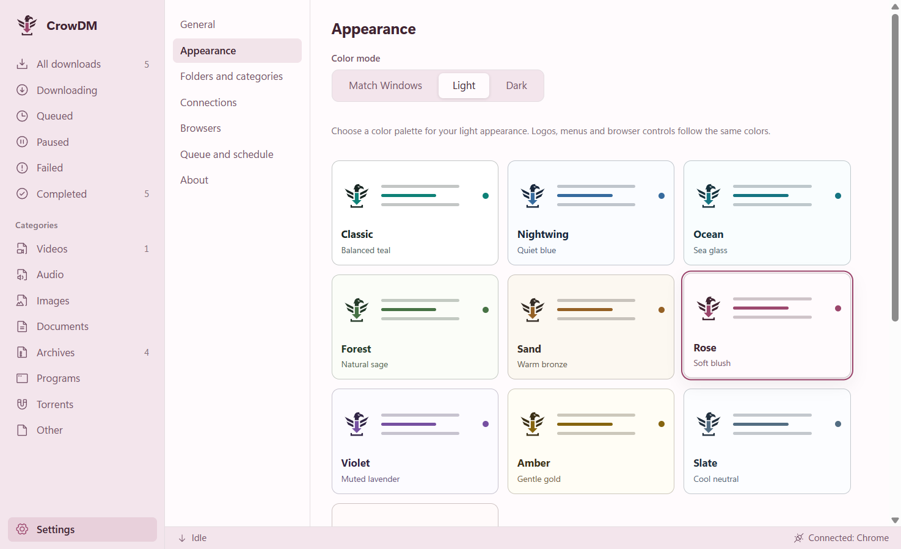
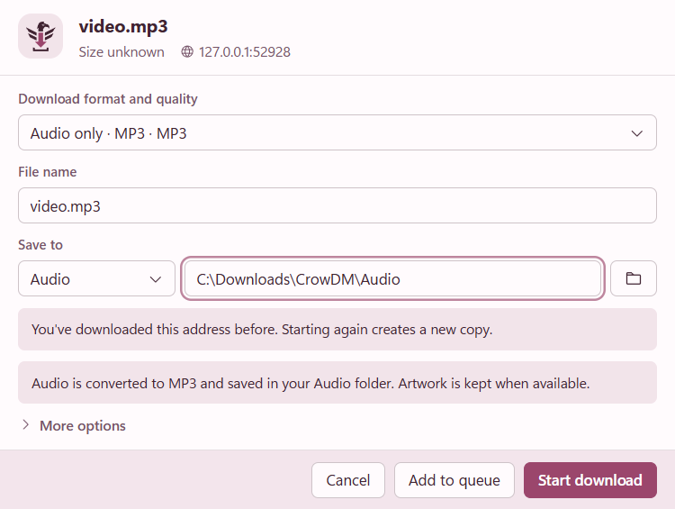

<p align="center"></p>

# CrowDM

A Windows download manager with fast segmented transfers, native torrents,
multipart download packages, browser capture and video downloads. Built for clear control over
your files: pause, resume, queue, schedule, sort, and find them again.

**[Download the 0.3.1 preview](https://github.com/Syst4n/CrowDM/releases/tag/v0.3.1)**
· **[Installation and download guide](docs/INSTALL.md)**
· **[Report an issue](https://github.com/Syst4n/CrowDM/issues)**





## What CrowDM does well

- **Native torrents and magnets.** Open .torrent files or magnet links,
  choose files, pause/resume verified pieces and manage them in the queue.
  Windows handler registration, TCP/uTP peers, DHT, trackers, peer exchange,
  configurable ports and UPnP help connect to available peers. No default
  speed cap; actual speed depends on your swarm, connection and storage.
- **Link Grabber and packages.** Paste many links or collect supported file
  links from a page, review availability and duplicates, rename packages and
  keep related archive parts in one folder. The inbox is saved between runs.
  Package progress, pause/resume and quiet notifications keep batches manageable.
  Clipboard collection is optional; copying never starts a download by itself.
  Select links on a page and a faint Nightwing button appears beside them;
  click it to open the app's Link Grabber with the whole selection.
- **Updates on your terms.** An update screen shows versions, “What's New,”
  verified installer downloads and extension reload guidance. Updates are
  announced separately from ordinary development releases. Public GitHub
  download counts are shown by version without tracking installations.
- **Resumable transfers.** Up to 32 connections per file, adaptive fallback
  when servers limit connections, recovery after interruptions and restarts,
  remote-file change detection, speed limits, and optional checksum checks.
  Large files use bounded memory; the transfer suite includes a 100 GiB case.
- **Browser handoff.** Chrome, Edge and Firefox extensions catch ordinary
  downloads. CrowDM asks where to save them, with a browser fallback if you
  decline or the app is unavailable. Web pages are excluded by default.
- **Video and audio choices.** A faint Nightwing icon appears at the top right
  of web videos, expands on hover, and lists available qualities when clicked.
  Supported YouTube pages and finite HLS/DASH streams can be saved as MKV,
  available MP4 video with audio, or MP3 audio. Moving between YouTube videos
  or playlist items updates the target without refreshing the page.
- **Useful size information.** Direct sizes and available source estimates
  appear before starting. Finite HLS playlists are inspected and sampled.
  Estimates are marked; actual output sizes can differ after processing.
  Live/unbounded playlists are rejected and completed media is checked.
- **Organization without extra work.** Editable categories, automatic Audio
  destination for MP3, non-overwriting filenames, a folder button on each row,
  and previews for images, video frames and embedded audio artwork.
- **A quiet, adaptable interface.** Independent light, dark or Windows matching
  modes with ten palettes, Nightwing branding, a separate Appearance section, compact capture dialogs,
  resizable details, sorting and dated completion times. Subtle animation can
  be disabled and respects reduced-motion preferences. Windows notifications
  use CrowDM's own identity and logo, including portable and local builds.
- **Control while away.** Queue concurrency, schedules, tray operation,
  launch at startup, sleep prevention and actions after the queue finishes.

Downloads and settings stay on your PC. No CrowDM account, cloud transfer
service or analytics is required. Browser credentials are used for the
requested download and cleared from completed jobs.











Choose the same palette in either mode, or let Windows select light/dark.



## Install

1. Download the x64 setup EXE from [Releases](https://github.com/Syst4n/CrowDM/releases/tag/v0.3.1)
   and install it. Windows 10/11 is supported; installation is per user.
2. Start CrowDM and open **Settings → Browsers → Open extension folder**.
3. Chrome/Edge: enable Developer mode on the browser's extension page,
   choose **Load unpacked**, and select `chromium`. Firefox: load
   `firefox/manifest.json` as a temporary add-on from `about:debugging`.
4. Disable other download managers' browser extensions/integration so CrowDM
   handles your downloads. Browsers provide no exclusive priority setting.

The release includes a portable ZIP, separate extension ZIPs, a manual,
checksums and third-party notices. Video tools are included; Python is not
needed. See the [full guide](docs/INSTALL.md) for installation, updating,
portable use and troubleshooting.



## Preview status

0.3.1 is an early preview, released for testing and feedback. Installers are
unsigned, Firefox's extension is temporarily loaded, and installation of
announced updates remains manual. DRM, active live broadcasts, form POST
downloads and unsupported sites are excluded or handed back to the browser.
Universal video downloading is not possible. MP4 availability and quality
depend on the source; MP3 conversion does not improve source audio quality.

After upgrading, reload the browser extension and refresh already-open video
tabs once. Your history, settings, downloaded files and partial downloads
are retained. See [status](docs/STATUS.md) and [release notes](docs/releases/v0.3.1.md).

Torrents support v1/hybrid metadata. Sharing stops on completion; v2-only
torrents and completed-torrent seeding are not included. Link Grabber supports
direct links and simple host download pages, rather than every commercial host
or captcha/account system. Archive parts are retained; automatic extraction
is planned. GitHub downloads are not a count of active or unique users.

## Build and test

Windows, Rust 1.90+ with the MSVC toolchain, Visual Studio C++ Build Tools,
Node.js and pnpm are required. FFmpeg/FFprobe must be on PATH for the media
tool preparation step. WebView2 is required at runtime.

```powershell
git clone https://github.com/Syst4n/CrowDM
cd CrowDM
pnpm --dir apps/desktop install --frozen-lockfile
node scripts/prepare-sidecar.mjs --release
node scripts/third-party-notices.mjs
pnpm --dir apps/desktop tauri build
```

The EXE installer is written to `target/release/bundle/nsis/`. For development,
run `pnpm --dir apps/desktop tauri dev` after preparing the sidecar.

```powershell
$env:CROWDM_MEDIA_TESTS='1'
cargo test --workspace
node --test extensions/tests/background.test.mjs
```

The media tests run real yt-dlp and FFmpeg against generated local fixtures,
including selected resolutions, MP4/MP3, finite HLS/DASH, live-stream rejection,
pause/resume, queueing and database restoration. Native WebView and browser
regressions are described in [Testing](docs/TESTING.md).

## Documentation and licensing

[Architecture](docs/ARCHITECTURE.md) · [Browser integration](docs/BROWSER_INTEGRATION.md)
· [Performance](docs/PERFORMANCE.md) · [Contributing](CONTRIBUTING.md)
· [Third-party notices](docs/THIRD_PARTY_NOTICES.md)

An application source license has not yet been selected; all rights are
reserved until one is added. Bundled open-source tools and libraries retain
their own licenses, copyright notices and upstream source locations.
