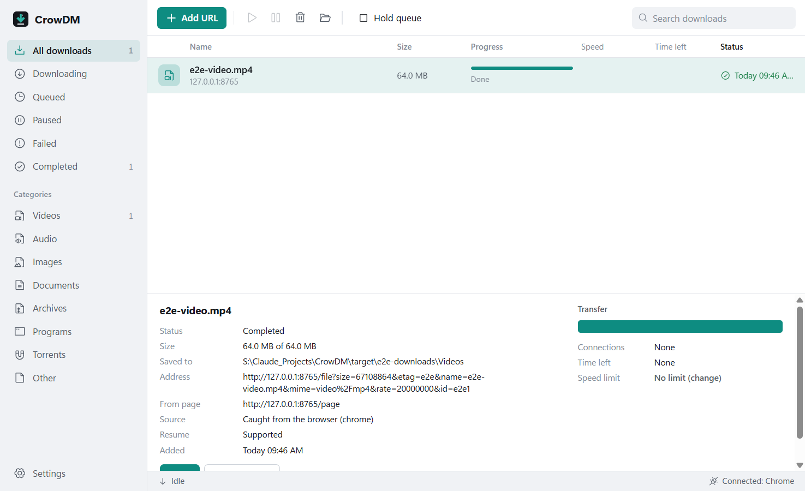
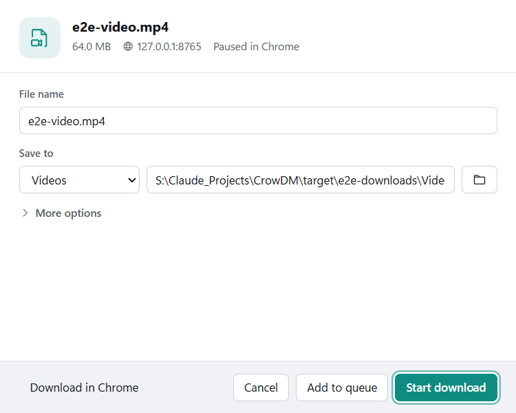

# CrowDM

CrowDM is a free download manager for Windows 10 and 11. When you click a
download link in Chrome, Edge or Firefox, CrowDM catches it and asks where to
save it, then downloads it over several connections with pause, resume,
queues, schedules and speed limits. It runs entirely on your PC: no account,
no server, no tracking.



## Features

- **Catches browser downloads.** Any ordinary file download, whatever its
  type. The browser keeps the download paused until you decide, and gets it
  back if you choose "Download in Chrome", close the dialog, or if CrowDM is
  not available, so nothing is lost or downloaded twice.
- **Download dialog** with name, size, source, folder and category; opens in
  about 20 ms while it is loaded and about half a second the first time.
- **"Download video" button** over web videos that are plain files.
- **Fast, careful transfers:** up to 32 connections per file, adapting when a
  server allows fewer; resume after pauses, crashes and restarts; checks that
  the file on the server has not changed; optional MD5/SHA-1/SHA-256 check.
- **Large files:** tested with a 100 GiB file; memory use does not grow with
  file size.
- **Organized folders:** one download folder with editable categories
  (Videos, Audio, Images, Documents, Archives, Programs, Torrents, Other).
  Existing files are never overwritten.
- **Queue and schedule:** run queued downloads a few at a time, start and
  stop them at set times, and notify, close, sleep or shut down afterwards.
- **Tray operation,** start with Windows, light and dark themes.



## Install

1. Download `CrowDM_<version>_x64-setup.exe` from the
   [Releases](https://github.com/Syst4n/CrowDM/releases) page and run it. It
   installs for your user only and does not need administrator rights. The
   installer is not code-signed yet, so Windows SmartScreen may ask you to
   confirm ("More info", then "Run anyway").
2. Start CrowDM. It connects itself to Chrome, Edge and Firefox.
3. Add the browser extension (Settings > Browsers > "Open extension folder"):
   - **Chrome or Edge:** open `chrome://extensions` or `edge://extensions`,
     turn on **Developer mode**, click **Load unpacked**, choose the
     `chromium` folder.
   - **Firefox:** open `about:debugging#/runtime/this-firefox`, click
     **Load Temporary Add-on**, choose `firefox\manifest.json`. Firefox
     removes temporary add-ons when it restarts; a signed version is planned.
4. Click a download link. CrowDM's dialog appears; press **Start download**.

To uninstall, use Windows Settings > Apps. The uninstaller removes the
browser connection and the start-with-Windows entry; your downloaded files
stay where they are.

### Portable use

Put `CrowDM.exe` and `crowdm-host.exe` in a folder with an empty file named
`portable`. CrowDM then keeps its data in `data\` next to itself. It still
registers the browser connection for your Windows user when it starts; start
it once again if you move the folder.

## Using CrowDM

- **Add a link yourself:** Add URL (Ctrl+N), or copy a link and press Ctrl+V
  in the main window.
- **Start download** runs it now; **Add to queue** runs it when the queue has
  a free slot. Hold or start the queue from the toolbar.
- Right-click a download for open, show in folder, resume, pause, download
  again, queue, copy address and remove.
- If a link expires (the server answers "access denied"), select the download,
  choose **Update address**, and paste a fresh link to the same file; CrowDM
  checks it is the same file and continues.
- Settings > Browsers lets you turn catching off, exclude sites or file
  types, and leave small files to the browser. The extension's toolbar
  button can switch catching off for one browser.

## Building from source

Requirements: Windows 10/11, Rust 1.90 or newer (MSVC toolchain), Node.js 20+
and pnpm, Visual Studio Build Tools (C++), WebView2 runtime (included with
Windows 11).

```
git clone https://github.com/Syst4n/CrowDM
cd CrowDM
pnpm --dir apps/desktop install
node scripts/prepare-sidecar.mjs --release
pnpm --dir apps/desktop tauri build
```

The installer is written to `target/release/bundle/nsis/`. For development,
`pnpm --dir apps/desktop tauri dev` runs the app with hot reload (run
`node scripts/prepare-sidecar.mjs` once first).

Tests: `cargo test --workspace`; end-to-end tests and benchmarks are described
in [docs/TESTING.md](docs/TESTING.md) and [docs/PERFORMANCE.md](docs/PERFORMANCE.md).

## Documentation

- [Architecture](docs/ARCHITECTURE.md): how the engine, app, host and
  extensions fit together.
- [Browser integration](docs/BROWSER_INTEGRATION.md): extension ids,
  registration, protocol, failure behaviour, video button.
- [Decisions](docs/DECISIONS.md): why the stack and key designs were chosen.
- [Testing](docs/TESTING.md) and [Performance](docs/PERFORMANCE.md): what is
  tested and measured, and what is not.
- [Status](docs/STATUS.md): what works, what is next, known issues.
- [Contributing](CONTRIBUTING.md).

## License

Not chosen yet; see [docs/STATUS.md](docs/STATUS.md). Until a license is
added, all rights are reserved.
